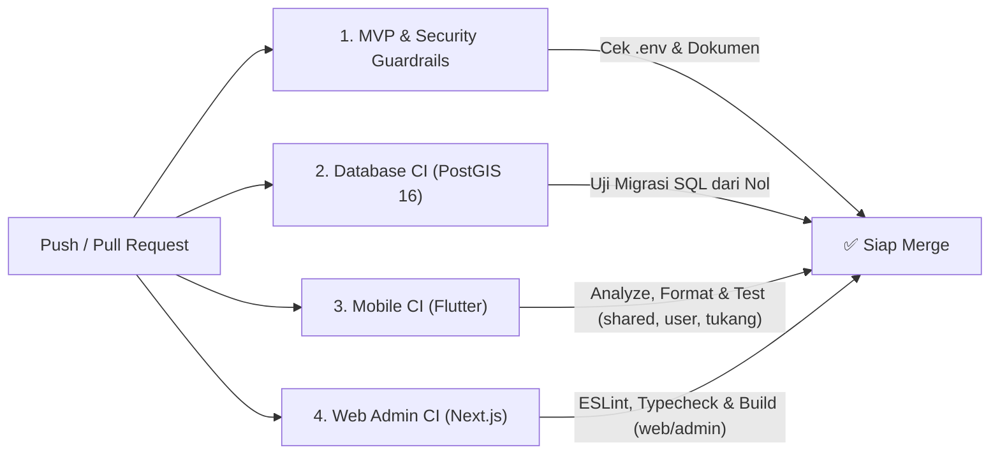

# Panduan Git, Branching, Pull Request (PR), & CI/CD — Project "Beres" (v1.4.0)

Dokumen ini (`docs/GIT_AND_CICD.md`) menetapkan standar pengelolaan kode (*Version Control*), strategi *branching*, format *commit*, aturan *Pull Request (PR)*, dan alur otomatisasi **CI/CD** untuk monorepo **Beres**.

---

## 1. Strategi Branching (Git Flow Ringkas Berbasis Milestone)

Repositori menggunakan 2 branch utama dan branch fitur per Milestone/Requirement:

1. **`main` (Production-Ready):**
   * Branch suci yang selalu stabil, bersih, dan siap rilis.
   * Dilarang melakukan *push* langsung ke `main`. Semua perubahan wajib melalui **Pull Request (PR)** yang lolos GitHub Actions CI.
2. **`develop` (Integration Branch):**
   * Tempat penggabungan hasil pengerjaan setiap Milestone (`M0` s/d `M8`) sebelum diuji secara menyeluruh (E2E) dan di-*merge* ke `main`.
3. **Feature / Fix Branches (Format Penamaan Wajib):**
   * Gunakan awalan Milestone dan ID Requirement dari [`docs/PRD.md`](./PRD.md) agar mudah dilacak:
     * `feat/M1-FR-001-email-otp-single-role`
     * `feat/M3-BR-15-BR-17-bid-limit-auto-clear`
     * `feat/M4-BR-05-nota-immutability-revision`
     * `feat/M5-BR-67-payment-dispute-report`
     * `fix/M6-BR-51-cancel-draft-privacy`

---

## 2. Standar Pesan Commit (Conventional Commits + ID PRD)

Setiap pesan *commit* wajib menggunakan format **Conventional Commits** dan menyertakan **ID `FR-xxx` / `BR-xx` / `M0–M8`** di dalam kurung:

```text
<tipe>(<milestone/ID>): <ringkasan singkat dalam bahasa Indonesia/Inggris>
```

### Contoh Commit yang Benar:
* `chore(M0): inisialisasi monorepo, PRD v1.4.0, dan skema awal PostGIS`
* `feat(M1/FR-001,BR-44): implementasi login email OTP dan validasi 1 email 1 peran`
* `feat(M3/BR-15,BR-17): batasi lamar maks 5 job dan auto-withdraw saat di-lock`
* `feat(M4/BR-31): tambah cron timer 30 menit wajib klik berangkat setelah nota approved`
* `test(M5/BR-67): tambah E2E test laporan masalah pembayaran dan suspend permanen user`

---

## 3. Aturan Pull Request (PR) & Code Review

Setiap kali membuat Pull Request, template otomatis di [`.github/pull_request_template.md`](../.github/pull_request_template.md) akan muncul. Sebuah PR **HANYA BOLEH di-merge** jika:
1. Seluruh centang **Definition of Done (Bagian 16 `PRD.md`)** terpenuhi.
2. Seluruh pemeriksaan otomatis di **GitHub Actions CI (`.github/workflows/ci.yml`)** berwarna **Hijau (Passed)**.
3. Menyertakan **Test Negatif** untuk setiap `BR-xx` yang dikerjakan (membuktikan server menolak manipulasi langsung lewat API tanpa melalui UI).

---

## 4. Arsitektur Pipeline CI/CD (`.github/workflows/ci.yml`)

Pipeline CI berjalan otomatis pada setiap `push` dan `pull_request` ke `main` maupun `develop`, terbagi menjadi 4 gerbang pemeriksaan paralel:



### Detail 4 Job di GitHub Actions:
1. **`mvp-guardrails`:** Memastikan seluruh dokumen inti (`AGENTS.md`, `PRD.md`, dll.) utuh dan memastikan tidak ada file rahasia `.env` yang tidak sengaja ter-*commit* ke dalam Git.
2. **`database-ci`:** Menyalakan container resmi **PostgreSQL 16 + PostGIS 3.4**, lalu mengeksekusi seluruh file di `supabase/migrations/*.sql` dari nol untuk menjamin skema tabel, enum 10 status, dan data awal (`categories` & `app_configs`) bebas dari error sintaks.
3. **`mobile-flutter-ci`:** Menjalankan `flutter pub get`, `dart format --set-exit-if-changed`, `flutter analyze --fatal-infos`, dan `flutter test` secara berurutan pada:
   * `mobile/shared`
   * `mobile/user`
   * `mobile/tukang`
4. **`web-admin-ci`:** Menjalankan `npm ci`, `npm run lint`, dan `npm run build` pada `web/admin`.

---

## 5. Alur Deployment (CD — Continuous Deployment)

| Komponen | Target Deployment | Mekanisme Otomatisasi |
| :--- | :--- | :--- |
| **Database & RPC (`supabase/`)** | **Supabase Cloud Project** | Melalui `supabase db push` via GitHub Actions saat PR di-*merge* ke `main` (setelah backup otomatis `NFR-17`). |
| **Web Admin (`web/admin`)** | **Vercel / Cloudflare Pages** | Terhubung otomatis ke branch `main` (Production) dan *Preview Deployment* otomatis untuk setiap Pull Request. |
| **Mobile Apps (`mobile/user` & `mobile/tukang`)** | **Google Play Console (Internal Testing) & Apple TestFlight** | Menggunakan GitHub Actions + **Fastlane / Codemagic** untuk mem-build `.aab` (Android) dan `.ipa` (iOS) setiap kali rilis tag versi dibuat (contoh: `v1.0.0-beta.1`). |
