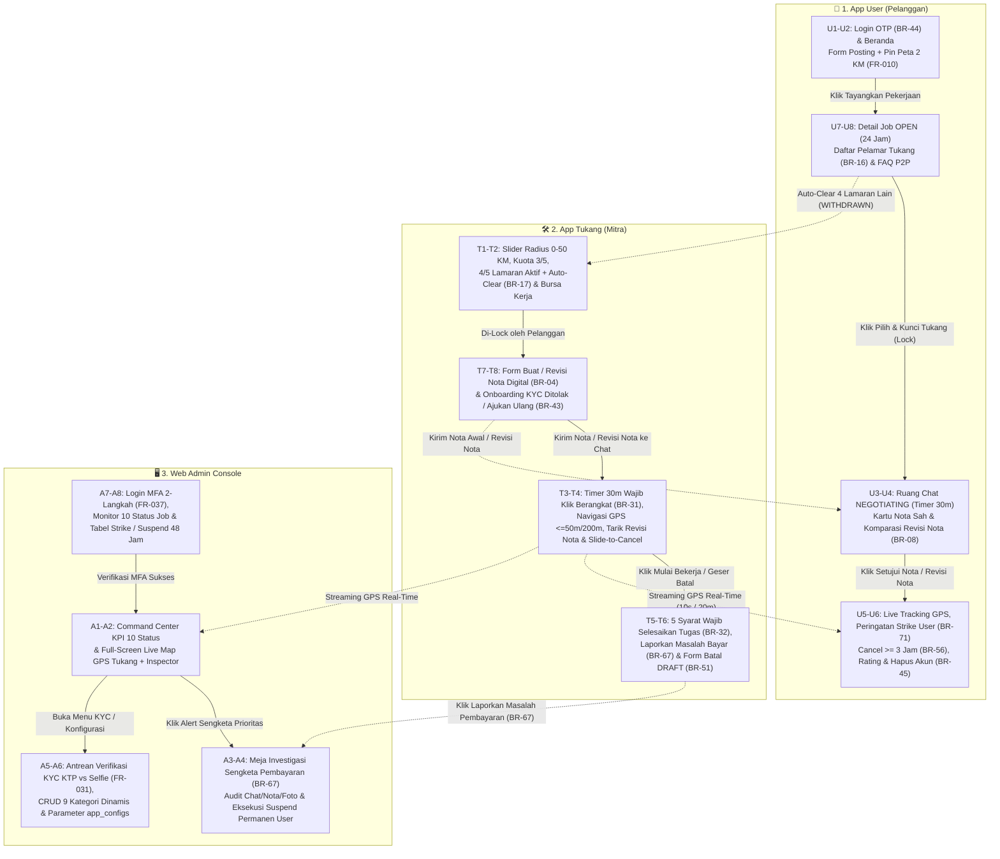

# Panduan Desain UI/UX & Alur Layar Stitch — BERES v1.4.0

> **Metodologi:** Dirancang menggunakan **`ui-ux-pro-max`** ([`design-system/beres/MASTER.md`](../design-system/beres/MASTER.md)) dengan prinsip **Anti-AI-Slop Industrial Utility & Field Readability** dan mengacu 100% pada **[`docs/PRD.md`](./PRD.md) (v1.4.0)**.

---

## 1. Daftar Project Stitch & Design System

Seluruh desain UI/UX terbagi ke dalam **3 Project Stitch** sesuai aplikasi pada monorepo:

| Aplikasi Monorepo | Nama Project di Stitch | Stitch Project ID | Design System ID | Target Viewport |
| :--- | :--- | :--- | :--- | :--- |
| **`mobile/user`** | **Beres v1.4.0 — App User (Pelanggan)** | `16256979667973068828` | `assets/16286490318637858961` | Mobile (`390x844`) |
| **`mobile/tukang`** | **Beres v1.4.0 — App Tukang (Mitra)** | `1165624962236756944` | `assets/13975792501232352645` | Mobile Field (`390x844`) |
| **`web/admin`** | **Beres v1.4.0 — Web Admin Console** | `2226139193804777079` | `assets/13255218215190507764` | Desktop (`1440x900`) |

---

## 2. Diagram Keterhubungan Alur Layar (End-to-End Screen Flow)

---

## 3. Rincian Layar & Pemetaan Fitur PRD v1.4.0

### A. `Beres v1.4.0 — App User (Pelanggan)` (`projects/16256979667973068828`)
1. **Screen `5b7fc8b7cb59428f9d5766152ce200cb` — `U1 & U2: Posting Pekerjaan Baru Pelanggan`**
   - Status login OTP 6 digit & penegakan **`1 Email = 1 Peran (BR-44)`**.
   - Indikator `[0/3 STRIKE BULAN INI]` & lokasi *Reverse Geocoding OS HP* (`Kel. Tebet Timur, Kec. Tebet`).
   - Grid 9 kategori pertukangan dinamis (ikon vektor bersih, bebas emoji).
   - Form keluhan + upload maks 3 foto + **Peta Pin Lokasi dengan lingkaran batas geser maksimal `2,0 km` (`FR-010`)** + banner privasi `BR-16`.
2. **Screen `075fcc5878a04b25a26b1b194968ba76` — `U7 & U8: Bursa Pelamar Tukang, Kunci Tukang & Buku Saku Aturan P2P`**
   - Countdown masa tayang 24 jam (`BR-30`) + tombol *Batalkan Posting*.
   - Daftar pelamar tukang (menampilkan foto, nama, badge KYC, rating, hari aktif, jarak, & ulasan tanpa bocor kontak/alamat) + tombol **"Pilih & Kunci Tukang Ini (Lock)"**.
   - Accordion **Buku Saku & FAQ Resmi Aturan Pembayaran Langsung (P2P) & Sistem Strike (Lampiran C)**.
3. **Screen `789eaf1b928c46d49ea3092f6c63dfc2` — `U3 & U4: Negosiasi Chat & Revisi Nota Digital Pelanggan`**
   - Header status `NEGOTIATING` + **Timer Chat 30 Menit (`BR-70` — Tanpa Strike bila timeout)** + tombol *Lepas ke Portal*.
   - Kartu **Nota Digital Sah (`#NTA-2026-0412-V1` — `Rp 100.000`, Terkunci/`Immutable` `BR-05`)**.
   - Kartu **Alert Komparasi Revisi Nota (`#NTA-2026-0412-V2` — `BR-05`, `BR-08`)** yang menyandingkan **Harga Nota Awal (`Rp 100.000`) vs Harga Revisi Baru (`Rp 150.000` / `+Rp 50.000`)** beserta tombol **Setujui Revisi** dan **Tolak Revisi**.
4. **Screen `0b7f79668ca44d87a692edea50dd8068` — `U5 & U6: Live Tracking GPS, Strike Rule, Rating & Penyelesaian Pelanggan`**
   - Peta *Live Tracking* GPS Tukang (`ON_THE_WAY` $\rightarrow$ `ARRIVED` $\rightarrow$ `WORKING` $\rightarrow$ `COMPLETED`).
   - Banner peringatan **Strike User (`BR-71` — Wajib membalas chat Tukang $\le 30$ menit saat `ON_THE_WAY`/`ARRIVED`)**.
   - Indikator **Tombol Batal Terkunci (< 3 Jam)** dan baru aktif otomatis saat **`ON_THE_WAY` $\ge 3$ Jam (`BR-56`)**.
   - Tampilan privasi `CANCEL_PENDING` (`BR-53` — User hanya melihat alasan pembatalan tukang).
   - Galeri bukti hasil kerja tukang, form **Rating 1–5 Bintang & Ulasan (`FR-025`)**, serta tombol **Hapus Akun Permanen (`BR-45`)**.

---

### B. `Beres v1.4.0 — App Tukang (Mitra)` (`projects/1165624962236756944`)
1. **Screen `c9bb16ddf12e40ba9c29cbda4e18d8c1` — `Screen T1 & T2: Bursa Kerja & Status Operasional Mitra`**
   - Header kontras tinggi dengan badge `KYC KTP TERVERIFIKASI`, **Kuota Mingguan `3/5 Job Selesai` (`BR-21`)**, dan **Strike Bulan Ini `[1/3]`**.
   - **Slider Radius Kerja `0–50 km` (`FR-003`)** & filter multi-kategori keahlian.
   - Panel **Lamaran Aktif `4/5 Pekerjaan` (`BR-15`)** + penjelasan **Auto-Clear (`WITHDRAWN` `BR-17`)** saat di-*lock* di 1 job.
   - Daftar pekerjaan terbuka (`OPEN`) dengan label `Kelurahan/Kecamatan` (`BR-16`).
2. **Screen `abe5d08c49ff4decb4606bba2da14241` — `Screen T7 & T8: Form Revisi Nota Digital (BR-04) & KYC Ditolak (BR-43)`**
   - Form khusus Tukang untuk membuat **Nota Awal** maupun **Revisi Nota** (input biaya jasa, tambah/hapus baris material dinamis, ringkasan komparasi otomatis `Rp 100.000 -> Rp 150.000`, & pilihan metode bayar rencana P2P).
   - Sub-modul **Status KYC Ditolak (`REJECTED`)** dengan alasan penolakan Admin & slot unggah ulang KTP/Selfie (`BR-43`).
3. **Screen `c9a1a5b5e3654bfbb32824fc40be6fbb` — `Screen T3 & T4: Eksekusi Lapangan, GPS & Revisi Nota`**
   - Banner **Timer Mundur 30 Menit Wajib Klik "Berangkat ke Lokasi" (`BR-31`)** dengan tombol taktil besar `56px` (peringatan *+1 Strike Tukang* bila lewat 30 menit).
   - Alamat lengkap pelanggan yang sudah terbuka + bar telemetri GPS (`Jarak: 42m • Akurasi: ±8m`), auto-detect `ARRIVED` ($\le 50\text{m}$), tombol manual **"Saya Sudah Tiba"** ($\le 200\text{m}$), & tombol **"Mulai Bekerja (`WORKING`)"**.
   - Kartu Revisi Nota berstatus `SENT` dengan tombol penyelamat **"Tarik / Batalkan Revisi Nota (`SUPERSEDED` `BR-08`)"**.
   - Komponen **Slide-to-Cancel (`BR-50`)** di bagian bawah layar.
4. **Screen `d99c8a6a610f43389bd734c361210b3b` — `Screen T5 & T6: Penyelesaian Tugas (BR-32), Sengketa (BR-67) & Pembatalan (BR-51)`**
   - Status `WORKING (TIDAK DAPAT DIBATALKAN — BR-65)`.
   - Checklist **5 Syarat Wajib Penyelesaian Tugas (`BR-32`)**: (1) Foto hasil kerja, (2) Pilihan **Metode Bayar Aktual** (`Transfer Bank` / `E-Wallet` / `Tunai`), (3) Upload bukti transfer (otomatis tersembunyi bila pilih Tunai), (4) Tidak ada Revisi Nota `SENT`, (5) Checkbox konfirmasi lunas.
   - Kartu darurat merah **"Laporkan Masalah Pembayaran ke Admin (`BR-67`)"** (melepas ikatan job aktif sementara & masuk antrean prioritas Admin).
   - Preview **Form Pembatalan Tukang (`DRAFT` belum terlihat oleh User vs `SUBMITTED` `BR-51`–`BR-55`)**.

---

### C. `Beres v1.4.0 — Web Admin Console` (`projects/2226139193804777079`)
1. **Screen `d40ac1bb60514e77ac053d8077bba50a` — `Beres Ops Console — Command Center & Live Map (A1 & A2)`**
   - Strip telemetri 10 status pekerjaan (`OPEN`, `NEGOTIATING`, `NOTA_APPROVED`, `ON_THE_WAY`, `ARRIVED`, `WORKING`, `CANCEL_PENDING`, `COMPLETED`, `CANCELLED`, `EXPIRED`) + banner prioritas sengketa pembayaran.
   - **Full-Screen Live Map GPS Tukang** (pin `ON_THE_WAY` termasuk indikator lewat 3 jam `BR-56`, pin `ARRIVED` radius 50m, pin `WORKING`) + **Real-Time Inspector Drawer**.
2. **Screen `073f984778884aafa881051968728e62` — `Beres Ops Console — Meja Investigasi Sengketa Pembayaran (BR-67) & Audit Nota (A3 & A4)`**
   - **Tri-Pane High-Density Audit Workspace**:
     - Kolom 1: Audit Nota Awal (`Rp 100.000`) vs Revisi Nota Sah (`Rp 150.000`) vs Metode Bayar Aktual (kekurangan `-Rp 100.000`).
     - Kolom 2: Transkrip Chat lengkap + komparasi Foto Keluhan vs Foto Hasil Kerja + log geofence GPS.
     - Kolom 3: Panel Eksekusi Admin dengan tombol merah tegas **"EKSEKUSI SUSPEND PERMANEN AKUN USER (TANPA TOLERANSI 3X) & TUTUP JOB" (`BR-67`)**.
3. **Screen `2b679e5cc00f4f7b8db3de791e0859eb` — `Beres Ops Console — Verifikasi KYC Tukang (A5) & Parameter app_configs (A6)`**
   - Antrean verifikasi KYC KTP vs Selfie berdampingan + tombol Setujui / Tolak wajib alasan (`BR-43`).
   - Tabel **CRUD 9 Kategori Dinamis (`FR-035`)** (proteksi larangan hapus kategori berhistori) + tabel **10 Parameter Sistem `app_configs` (`FR-036`)**.
4. **Screen `d666de9016334acbbdcc7dc3dd78ca37` — `Beres Ops Console — Monitor 10 Status Job (A7) & Manajemen Akun / Strike (A8)`**
   - Tabel master monitor 10 status job & SLA timer (`BR-31`, `BR-51`, `BR-56`).
   - Kartu **Verifikasi Keamanan Login Admin MFA 2 Langkah (6-Digit TOTP `FR-037`)**.
   - **Buku Besar Kepatuhan & Strike Ledger (`BR-57`, `BR-71`, `BR-67`)** yang menampilkan status **Suspend Otomatis 2 Hari (48 Jam) saat Strike ke-4** dan **Suspend Permanen**.
